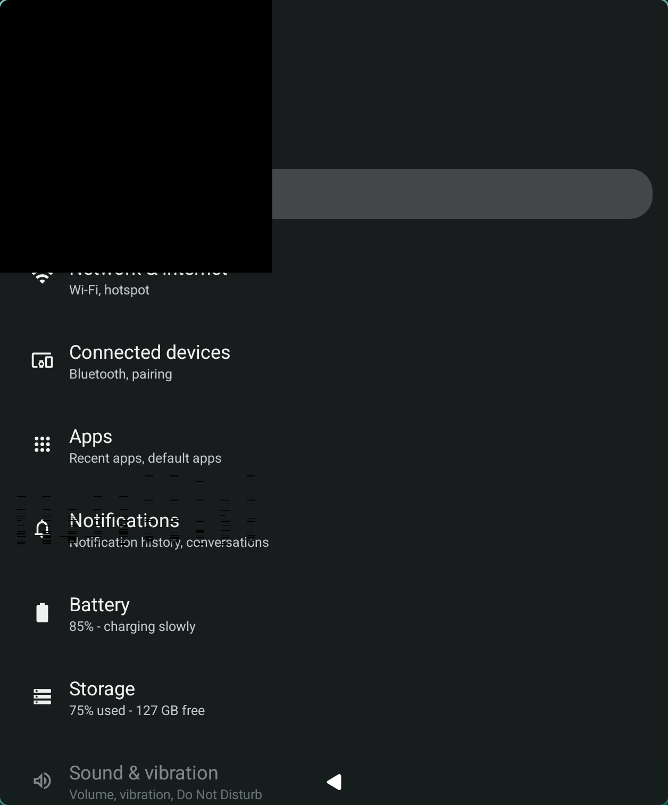

# Upstream pull requests and issues

What this fork plans to send to Waydroid, in plain words. Items 11 to 14 are what the fork has that is not sent yet. Merged on 2026-11-07 by aleasto: [android_vendor_waydroid#57](https://github.com/waydroid/android_vendor_waydroid/pull/57), [#58](https://github.com/waydroid/android_vendor_waydroid/pull/58), and [#59](https://github.com/waydroid/android_vendor_waydroid/pull/59). Open, each with his first review questions from 2026-11-07: [#92](https://github.com/waydroid/android_hardware_waydroid/pull/92), [#93](https://github.com/waydroid/android_hardware_waydroid/pull/93) for issue [waydroid#2470](https://github.com/waydroid/waydroid/issues/2470), and [#94](https://github.com/waydroid/android_hardware_waydroid/pull/94) for issue [waydroid#2471](https://github.com/waydroid/waydroid/issues/2471). Opened on 2026-11-10: [#95](https://github.com/waydroid/android_hardware_waydroid/pull/95), the refresh rate split out of #93, with [android_device_waydroid_waydroid#18](https://github.com/waydroid/android_device_waydroid_waydroid/pull/18), and [#96](https://github.com/waydroid/android_hardware_waydroid/pull/96), the black flashes. The draft answers are under "Reply to review" in sections 1, 3, and 4. Replies are posted on [#2464](https://github.com/waydroid/waydroid/issues/2464#issuecomment-6617138955) and [#91](https://github.com/waydroid/android_hardware_waydroid/pull/91#issuecomment-6618281541), and the NVIDIA bug report is [forum thread 387942](https://forums.developer.nvidia.com/t/vulkan-some-nv12-dma-bufs-imported-as-two-plane-images-read-back-wrong-615-78-08/387942). A question about media controls is posted on [#868](https://github.com/waydroid/waydroid/issues/868#issuecomment-6686462350), and one about title bars and Back on [#1119](https://github.com/waydroid/waydroid/issues/1119#issuecomment-6704203289). Nothing else has been posted.

1. **Smoother window resizing, without the crash.** Dragging a window edge made Android rebuild its screen about 150 times in 8 seconds, and Android's graphics crashed during the rebuilds ([#2464](https://github.com/waydroid/waydroid/issues/2464)). [#92](https://github.com/waydroid/android_hardware_waydroid/pull/92) cuts the rebuilds to about 15 and stretches the old frame meanwhile. It is open, with 150 ms as the default since the maintainer asked why it should stay off by default once the null check was merged. [android_vendor_waydroid#57](https://github.com/waydroid/android_vendor_waydroid/pull/57), the null check that SurfaceFlinger crashed on, is merged, and the maintainer closed #2464. [Drafts](#1-resizing-and-the-surfaceflinger-crash)
2. **No more black flashes in the full Waydroid window.** The window was shown before Android finished drawing it. Open as [#96](https://github.com/waydroid/android_hardware_waydroid/pull/96) since 2026-11-10. [Draft](#2-black-flashes-in-the-full-ui)
3. **Several app windows behave.** Each window keeps its own size and closes with its app. Closing the full Waydroid window closes only its own apps. Android follows the monitor's refresh rate. Open as issue [waydroid#2470](https://github.com/waydroid/waydroid/issues/2470) and PR [#93](https://github.com/waydroid/android_hardware_waydroid/pull/93). On 2026-11-10 the refresh rate moved to [#95](https://github.com/waydroid/android_hardware_waydroid/pull/95), rewritten smaller, and it now makes Android follow the monitor a window is on; it needs [android_device_waydroid_waydroid#18](https://github.com/waydroid/android_device_waydroid_waydroid/pull/18). #93 dropped from +494/−66 to +258/−43. [Drafts and plan](#3-several-app-windows)
4. **Video shows in its own colours.** Ordinary (SDR) video no longer looks washed out, because Android stops brightening its dark parts; stock Waydroid does this too. HDR video shows as HDR when the compositor runs the monitor in HDR mode. Open as issue [waydroid#2471](https://github.com/waydroid/waydroid/issues/2471). [android_vendor_waydroid#58](https://github.com/waydroid/android_vendor_waydroid/pull/58) is merged; [#94](https://github.com/waydroid/android_hardware_waydroid/pull/94) is open. [Drafts](#4-video-colours)
5. **No audio crackles at high sample rates.** Posted as [a comment](https://github.com/waydroid/android_hardware_waydroid/pull/91#issuecomment-6618281541) on [#91](https://github.com/waydroid/android_hardware_waydroid/pull/91), someone else's open audio PR, which already has half of the fix. [Draft](#5-audio-at-high-sample-rates)
6. **Video buffers in GPU memory go straight to the compositor.** On hold: upstream has nothing that creates those buffers yet. [Note](#6-gpu-memory-buffers-as-dma-bufs)
7. **Bug report to NVIDIA.** Their driver misreads some video buffers, which shows as green or colourless frames. Posted as [forum thread 387942](https://forums.developer.nvidia.com/t/vulkan-some-nv12-dma-bufs-imported-as-two-plane-images-read-back-wrong-615-78-08/387942), with a small program that shows the bug. [Draft](#7-nvidia-misreads-two-plane-nv12-imports)
8. **Android media players in the desktop's media controls.** Apple Music, YouTube and other players show in the desktop's media widget with their title, cover and position, and take play, pause, skip and seek. Requested in [waydroid#868](https://github.com/waydroid/waydroid/issues/868) since 2023. Two PRs, one in `android_frameworks_waydroid` and one in `waydroid/waydroid`, built the way Waydroid already forwards notifications. [Asked the maintainer on #868](https://github.com/waydroid/waydroid/issues/868#issuecomment-6686462350) how he wants the PRs; no reply yet, and not written yet. The fork's working version runs as a separate helper, which upstream would not take as it is. [Plan](#8-media-controls-over-mpris)
9. **Desktop title bars on app windows.** On KDE, each app window gets KWin's own title bar, with minimize, maximize and close. Where the compositor draws none, as on GNOME, the window draws its own, with a Back button next to the window buttons. Requested in [waydroid#1119](https://github.com/waydroid/waydroid/issues/1119), where the maintainer said it needs one Android display per app. The fork's `waydroid-app-displays` has that, so it is a comment on the issue, not a PR. [Posted](https://github.com/waydroid/waydroid/issues/1119#issuecomment-6704203289) on 2026-11-07; it also asks the maintainer about the Back patch in item 10. [Draft](#9-desktop-title-bars)
10. **Back leaves an app's first screen on other displays.** Waydroid's patch 0032 ignores Back on a task's first screen unless the full UI is active, so an app on its own display could never leave its first screen. A new vendor patch keeps that rule on the default display only. Merged as [android_vendor_waydroid#59](https://github.com/waydroid/android_vendor_waydroid/pull/59) on 2026-11-07. [Draft](#10-back-on-other-displays)
11. **Android's graphics on NVIDIA, through Venus.** Not sent. The fork's biggest piece: Android renders through Vulkan on the host's NVIDIA driver instead of software rendering. It needs changes in virglrenderer, Mesa, Waydroid's gralloc and the Waydroid host tools, so it starts with upstream projects and a question to the maintainer. [Plan](#11-nvidia-graphics-through-venus)
12. **Video decoded on the host GPU.** Not sent. Depends on item 11. [Plan](#12-video-decoded-on-the-host-gpu)
13. **Each app in its own window.** Not sent as code; asked on #1119 (item 9). [Plan](#13-each-app-in-its-own-window)
14. **Kept in the fork.** Widevine, the installers and the test tooling. [List](#14-kept-in-the-fork)

Every head branch below starts from upstream `lineage-20` and is on `TechyAditya/android_hardware_waydroid` unless it says otherwise. Each one compiles alone with `stack/build.sh`. The changes ran together in the `all-fixes` build, not branch by branch. To open a pull request from a draft, save the body to a file and run:

```sh
gh pr create -R waydroid/REPO -B lineage-20 -H TechyAditya:BRANCH --title "TITLE" --body-file BODY.md
```

## 1. Resizing and the SurfaceFlinger crash

[#92](https://github.com/waydroid/android_hardware_waydroid/pull/92) is open. Its description is current, and every review thread is resolved. Its interval is 150 ms by default since 2026-11-08, and 0 turns it off. A launch still reconnects the display once.

#2464 can close once both PRs are merged and the reporter confirms that both crashes are gone: the SurfaceFlinger SIGSEGV, and the composer deaths (SIGABRT, signal 13) after which SurfaceFlinger aborts. The SurfaceFlinger patch fixes the first. The composer deaths have no confirmed cause; #92 made them stop on this setup. So neither PR says "Fixes", which would close the issue on merge. Close it by hand after the reporter replies.

### PR: SurfaceFlinger null check (open as android_vendor_waydroid#57)

`waydroid/android_vendor_waydroid`, head `TechyAditya:sf-default-display`. The branch adds `waydroid-patches/base-patches-33/frameworks/native/0016-surfaceflinger-Check-for-a-missing-default-display-i.patch`. All 16 patches apply to LineageOS `android_frameworks_native` `lineage-20.0` (`915ad642`). It has not been built in an AOSP tree. The 5-byte binary patch that `stack/surfaceflinger.sh` installs does the same thing and has run since 2026-11-02.

Title: `waydroid-patches: surfaceflinger: Check for a missing default display`

```markdown
Addresses waydroid/waydroid#2464, together with waydroid/android_hardware_waydroid#92.

## Problem

`SurfaceFlinger::getPhysicalDisplayIdsLocked()` calls `getDefaultDisplayDeviceLocked()->getPhysicalId()` without a check. Resizing a Waydroid window reconnects the primary display, and while it reconnects there is no default display. A `getPhysicalDisplayIds()` call in that gap, which DisplayManager makes after every reconnect, crashes SurfaceFlinger in `DisplayDevice::getId()`. That is the SIGSEGV in waydroid/waydroid#2464, at `surfaceflinger + 0x1579f0`. AOSP has the same code up to `main`, because phones do not disconnect their primary display.

## Change

`0016-surfaceflinger-Check-for-a-missing-default-display-i.patch` returns the other physical displays when there is no default display. With a default display, the result is unchanged.

waydroid/android_hardware_waydroid#92 makes the gap rarer by rate-limiting the reconnects during a drag. This patch removes the crash, including the reconnect at launch.

## Testing

The patch applies after patches 0001 to 0015 on LineageOS `android_frameworks_native` `lineage-20.0`. I have not built it in an AOSP tree. Since 2026-11-02 I have run the same check as a 5-byte change to the `20260927` x86_64 SurfaceFlinger binary, on Hyprland 0.57 with LineageOS 20 images. Before it, slow window drags crashed SurfaceFlinger in `getPhysicalDisplayIds`. Since then, systemd-coredump has recorded no SurfaceFlinger crash.
```

### Comment: answer the reporter on #2464

Posted on 2026-11-04 as [this comment](https://github.com/waydroid/waydroid/issues/2464#issuecomment-6617138955). The reporter had asked on 2026-11-03 whether to switch away from the Android 13 image.

```markdown
@CodeWithKhan07 No need to change images. The crash is in Android 13's SurfaceFlinger, and the LineageOS 20 images are the current x86_64 builds. Your report has two kinds of crash, and there is now a fix for each to try:

1. The SurfaceFlinger SIGSEGV in `getPhysicalDisplayIds`. waydroid/android_vendor_waydroid#57 adds the missing null check. Until an image has it, step 3 of my comment installs the same check as a binary patch. That patch matches only the `20260927` system image, and yours is that image: `system_datetime = 1790512621` is 2026-09-27.
2. The composer deaths (SIGABRT, and signal 13 at 10:37:16), after which SurfaceFlinger aborts. I could not find their cause, but they stopped for me with waydroid/android_hardware_waydroid#92 and `persist.waydroid.resize_interval_ms = 500` (step 2). Your Intel GPU uses `gralloc=gbm`, and the composer from that PR works with it.

Could you try both and say whether launching and resizing still crash? If either crash comes back, `coredumpctl list` and `waydroid logcat` around it would help. I only tested on Hyprland 0.57 with an NVIDIA GPU.
```

The maintainer merged #57, closed #2464 on 2026-11-07, and answered the composer deaths: "that is somewhat expected and not something we should consider needing a fix".

### Reply to review on #92 (posted)

The maintainer asked on 2026-11-07: "I wouldn't go add this complexity only to leave it off by default. Is there a good reason for this, other than making the surfaceflinger crash less likely, which we've now already fixed?"

On 2026-11-08 the default became 150 ms, folded into the first commit (head `ae18101`), and the PR description got the measurements below in place of the old "experimental, default 0" text. [Posted](https://github.com/waydroid/android_hardware_waydroid/pull/92#issuecomment-6718369707):

```markdown
Right, I forgot to update the default. It's 150 ms now (ae18101), and 0 turns it off.

With #57 in place, fast drags at 0 still crash Android elsewhere: `system_server` on `Unable to locate mode -1`, and SurfaceFlinger in `HWComposer::hasDisplayCapability()`. I put the measurements in the description.
```

Measured on 2026-11-08 with a drag script built on the gist's `test-resize.sh`: a floating single-window Settings window on Hyprland 0.57, resized through `hyprctl` in exact steps, with #57's check in place as the 5-byte binary patch. Interval 0 is upstream's path: `request_hotplug()` calls `do_hotplug()` directly when no timer exists. The composer was the `all-fixes` build, so it also had #93 and #94; neither changes when a drag of one window hotplugs. The first runs tracked only SurfaceFlinger and composer restarts; later runs also tracked `system_server` and kept the full log, so the crash column counts what each run could see.

| Drag | Interval | Runs | Hotplugs per drag | Android CPU time per drag | Crashes |
| --- | --- | --- | --- | --- | --- |
| 600 resizes in 5 s | 0 | 7 | 351 to 421 | 34 to 37 s | `system_server` restarted in all 4 runs where it was tracked; SurfaceFlinger crashed in 1 of the other 3 |
| | 150 | 6 | 31 to 35 | 3 to 8 s | none |
| | 500 | 6 | 10 to 18 | 3.5 to 4.6 s | none |
| 160 resizes in 6 s | 0 | 5 | 159 to 160 | 15 to 18 s | Launcher aborted in at least 3 |
| | 150 | 4 | 42 to 43 | 4 to 9 s | none |
| 150 resizes in 16 s | 0 | 3 | 141 to 150 | 14 to 28 s | none seen |
| | 150 | 2 | 109 | 11 to 18 s | none |

The crashes at 0, none of which #57 touches: `system_server` with `IllegalStateException: Unable to locate mode -1` in `DisplayInfo.findMode()` from `LogicalDisplayMapper.updateLogicalDisplaysLocked()`, which restarts zygote (waydroid/waydroid#2436 logs the same missing mode on an Intel GPU); SurfaceFlinger with a SIGSEGV in `HWComposer::hasDisplayCapability()` from `getDynamicDisplayInfo()`, where the display is still in `mDisplayData` but its `hwcDisplay` is null; and apps with `drawRenderNode called on a context with no surface!` in hwui. #84 reports a fourth, in `HWC2::impl::Display::present()`, on an Intel GPU with KDE.

## 2. Black flashes in the full UI

Open as [#96](https://github.com/waydroid/android_hardware_waydroid/pull/96) since 2026-11-10, head `TechyAditya:shm-copy-fence` (`26c240d`). Its screenshot is on the fork's `pr-assets` branch. Every composer built from an upstream-based branch shows the flashes on NVIDIA until this is merged, so test builds of the other PRs need these two commits cherry-picked. The description below is the one posted.

Title: `hwcomposer: wait for a layer's acquire fence before copying it to wl_shm`

```markdown
## Problem

`get_wl_buffer()` copies a layer into its wl_shm buffer before `apply_hwc_layer_to_surface_context()` waits on the layer's acquire fence. The copy can read a buffer that the GPU is still drawing. With `gralloc.default`, which Waydroid uses on NVIDIA, the client target always takes this path. Drawing starts with a clear to black, so frames show partly black.

## How to reproduce

On a setup where Android uses `gralloc.default` (`ro.hardware.gralloc=default`, as on NVIDIA GPUs):

1. Open the full UI window (`waydroid show-full-ui`).
2. Swipe between launcher pages, or open and scroll an app such as Settings.
3. Some frames show black rectangles where a layer hasn't been drawn yet, and text is torn. It's easiest to see in a screen recording at full frame rate, or in screenshots taken during an animation.

This screenshot is from today, Hyprland 0.57.2 with an NVIDIA RTX 3060 (driver 620.70.06), taken on the host just after Settings opened. The composer was built from a branch that doesn't have this change. The top left is black, and the "Notifications" row is torn:



## Changes

1. `hwcomposer: wait for a layer's acquire fence before copying it to wl_shm` waits on the fence before the copy.
2. `hwcomposer: skip a layer that isn't ready instead of copying it` skips the layer for that frame when the fence does not signal within 100 ms. The compositor keeps showing the previous frame. Before, the wait only logged the timeout and copied anyway.

## Testing

I recorded the full UI window at full frame rate while swiping between launcher pages 16 times, on Hyprland 0.57, CachyOS, an NVIDIA RTX 3060 (driver 615), and LineageOS 20 images.

| Build | Frames recorded | Frames more than 20% black |
| --- | --- | --- |
| Before | 740 | 608 |
| After | 822 | 0 |

Frame pacing averaged 17 ms with the change. I built the module outside the AOSP tree against the Android 13 VNDK v33 headers, so it has not been through a Soong build.
```

## 3. Several app windows

Posted on 2026-11-04 as issue [waydroid/waydroid#2470](https://github.com/waydroid/waydroid/issues/2470) and PR [waydroid/android_hardware_waydroid#93](https://github.com/waydroid/android_hardware_waydroid/pull/93), head `TechyAditya:pr/multi-window`. Since 2026-11-10 the branch has the three single-window commits and the two full UI commits, head `206558d`; the refresh rate commit moved to #95 (below), and #93's description and #2470's last line say so. Copilot's four review threads are fixed and resolved, and the Bugbot and GPT-5.6 Sol findings worth fixing are folded into their commits.

### Issue

Title: `[BUG] App windows: multi-window mode can't resize apps, and single-window mode mixes up sizes, keeps stale windows, closes every app with the full UI, and fixes the refresh rate at boot`

```markdown
**Describe the bug**

In multi-window mode (`persist.waydroid.multi_windows=true`), every app window is a window on one shared Android display. On Hyprland:

1. Resizing an app window resizes the whole Android display, not the app. Windows keep the size they started with or clip: an app started in a half-screen window stays half-size when maximized, and an app started full-size clips when tiled to half.
2. Android draws its own window shadows on that display, and they show around the host windows.
3. The on-screen keyboard opens as a new host window. When the compositor tiles it, the display resizes, and SurfaceFlinger can crash in `getPhysicalDisplayIds` (#2464).

#2426 and #2436 report other problems in this mode: focus stealing and a hotplug loop on app launch.

Single-window mode (`persist.waydroid.multi_windows=false`) avoids those, because the display always matches the focused window. With more than one app window, though:

4. Every app window shows the same Android display, and every `xdg_toplevel` configure resizes it. When focus moves between two windows of different sizes, the configure that arrives last wins, often the one for the window that loses focus. The focused app renders at the wrong size and is cropped.
5. A window stays open with its last frame after Android leaves its task, for example after Back on the app's root activity.
6. The composer's Wayland handlers can read a window after `hwc_set()` destroyed it, because Wayland calls listeners without a lock. I found this in review and did not see a crash from it.

In both modes:

7. Closing the full UI window (`waydroid show-full-ui`) calls `removeAllVisibleRecentTasks()`, which also closes apps shown in windows of their own on other displays.
8. The primary display has one config. Its vsync period is fixed at boot from the highest mode any output advertises, rounded to whole Hz. Android cannot follow a window to a monitor with another rate, and a 165.018 Hz panel gets a 165 Hz period. #973 reports the same fixed rate with two monitors.

**To reproduce**

1. Multi-window mode: open an app, then resize or tile its window. The app keeps its first size.
2. Single-window mode: open two apps in windows of different sizes and click between them. The focused app is cropped to the other window's size.
3. Single-window mode: press Back on an app's root activity. Its window stays open.
4. Open an app in its own window, then open and close `waydroid show-full-ui`. The app closes too.

**Expected behavior**

Each window shows its app at its own size and closes with its app. Closing the full UI closes only the apps it shows. Android runs at the refresh rate of the monitor that shows it.

**General information**

- Waydroid 1.6.3, LineageOS 20 images (system 20260927, vendor 20261022)
- Hyprland 0.57 on CachyOS, NVIDIA RTX 3060 Laptop GPU (driver 615), 165 Hz panel

waydroid/android_hardware_waydroid#93 fixes items 4 to 7. waydroid/android_hardware_waydroid#95 fixes item 8: it offers a display config for every monitor's rate, with the exact period, and switches Android to the rate of the fastest monitor showing a window. It needs waydroid/android_device_waydroid_waydroid#18.
```

### PR

Title: `hwcomposer: fix window size, lifetime and focus, and full UI close with several windows`

```markdown
Fixes items 4 to 7 of waydroid/waydroid#2470. Items 1 to 3 are multi-window mode problems that this PR does not change. For the resize crash, see waydroid/waydroid#2464 and #92.

The refresh rate fix for item 8 is a separate PR, #95, to keep this one simple to review. It started as the last commit here, and it now also makes Android follow the monitor a window is on. Both PRs add lines at the start of `window::~window()`, so whichever merges second needs a small rebase, which I'll do; it will also move #95's new surface handlers to the window lookup from commit 3 here.

## Changes

Single-window mode:

1. `hwcomposer: size the display from the focused window in single-window mode` remembers each window's configured size. Only the window with `XDG_TOPLEVEL_STATE_ACTIVATED` sets the display size, and windows that lose focus keep their last frame at their own size.
2. `hwcomposer: close a single-window app window when Android leaves its task` closes the window of the task Android left when it returns to a task that has a window, as multi-window mode does. A switch that `waydroid app launch` or a pending `setFocusedTask()` caused keeps both windows.
3. `hwcomposer: fix window lifetime and focus races in single-window mode` gives listeners a window ID that is never reused. Each handler looks the window up under `liveWindowsMutex` and uses it only while it holds the lock. The commit message lists four focus fixes that come with it.

Full UI:

4. `hwcomposer: close only the full UI's tasks with its window` records the tasks with a layer in the primary display's latest frame and removes only those. Removing the home task this way is harmless, because Android recreates it right away.
5. `hwcomposer: parse task ids without std::stoi` parses the task IDs from layer names without exceptions. The module is built without exceptions, so `std::stoi` on a malformed ID would abort it.

Multi-window mode is unchanged.

## Testing

These commits ran together in my build on Hyprland 0.57, CachyOS, an NVIDIA RTX 3060 (driver 615), and LineageOS 20 images:

- An app shown in its own window keeps running when the full UI window closes, and Settings opened in the full UI closes with it.

This branch alone was compiled, not run. I built the module outside the AOSP tree against the Android 13 VNDK v33 headers, so it has not been through a Soong build.
```

On 2026-11-08 the refresh-rate wording was narrowed in the commit message (head `f5a52d9`, code unchanged), in the PR description, and in the issue's last line. A test on KDE Plasma 6.8.2 with a 60 Hz virtual monitor (KRDP `--virtual-monitor` with a local FreeRDP client) showed why: with per-app windows, `waydroid-app-displays` switched Android to 60 Hz and back to 165.019 Hz on every move, and the app kept drawing at scale 1 and 1.6; with only the composer's window, Android stayed at 165.02 Hz on the 60 Hz monitor.

### Reply to review (posted)

Posted on 2026-11-08 after a Bugbot review of head `f5a52d9`, which found no bugs: [on the close handler](https://github.com/waydroid/android_hardware_waydroid/pull/93#discussion_r4505991707), [on `live_windows`](https://github.com/waydroid/android_hardware_waydroid/pull/93#discussion_r4505991820), and [on `std::stoi`](https://github.com/waydroid/android_hardware_waydroid/pull/93#discussion_r4505991911). The `std::stoi` comment and commit message were reworded in `206558d` (head `9e44127`), and that thread is resolved; the other two answer questions and stay open for the maintainer. The offers to move the close-handler hunk and the pointer set into commit 3 were dropped, because commits 1 and 2 would then read freed windows. The drafts below are the versions before those changes.

On 2026-11-07 the maintainer wrote "Not a full review yet since this is quite large" and left three inline questions. One reply per thread:

On `wayland-hwc.cpp` in `c91136d`, "none of this is related, is it?":

```markdown
It is, though the diff doesn't show why. Before this commit, only this handler erased a window. This commit adds a second place: when Android leaves a task, `hwc_set()` closes that task's window. `removeTask()` is what makes Android leave the task, and it waits on a binder call while SurfaceFlinger keeps composing, so `hwc_set()` can erase and free `window` before `removeTask()` returns. The old code read `window->display`, `window->taskID` and `window->appID` after that call. Copying them first keeps the handler from reading the freed window; the `window->display` to `display` changes are the same fix.

Commit 3 then replaces this with a lookup that also covers the other handlers. If it's easier to review, I can move this hunk into commit 3, so that this commit only adds the closing.
```

On `wayland-hwc.h` in `5f64b75`, "how is this different from display::windows?":

```markdown
`display::windows` owns the windows, keyed by task or app ID, under `windowsMutex`. `live_windows` answers another question: is the `window *` that Wayland passes to a listener as `data` still alive? A listener has only that pointer, not the key, and it can't take `windowsMutex`: `hwc_set()` holds it while `window::create()` waits in `wl_display_roundtrip()` for the new window's configure, which the Wayland thread dispatches, so a listener that took it would deadlock.

Commit 3 replaces the pointer set with `liveWindows`, which maps an ID that is never reused to the window, under its own `liveWindowsMutex`, because a freed pointer can come back as a new window. I can fold the set into commit 3, so that only the final form is in the series.
```

On `wayland-hwc.cpp` in `dae5b49`, "> which is built without exceptions ?":

```markdown
Soong compiles C++ with `-fno-exceptions` unless a module adds `-fexceptions` ([global.go](https://android.googlesource.com/platform/build/soong/+/refs/heads/android13-release/cc/config/global.go)), and this module doesn't. `std::stoi` itself is in libc++ and still throws `std::invalid_argument` or `std::out_of_range`, but nothing in the composer can catch it, so a bad id aborts the composer. The comment says that badly; I'll change it to "std::stoi throws on a malformed id, and the composer cannot catch it".

I haven't seen a malformed id, though: the ids come from SurfaceFlinger's `TID:<id>#...` layer names, so this is defensive. If you'd rather keep `stoi`, I'll drop the commit.
```

### Plan: one refresh-rate PR that follows the monitor

Opened on 2026-11-10 as [#95](https://github.com/waydroid/android_hardware_waydroid/pull/95) from `TechyAditya:pr/refresh-rates`, with [android_device_waydroid_waydroid#18](https://github.com/waydroid/android_device_waydroid_waydroid/pull/18) from `TechyAditya:task-hal-1.1`; #93 was force-pushed to `206558d` and its description edited, [a comment](https://github.com/waydroid/android_hardware_waydroid/pull/93#issuecomment-6761705065) says why, and #2470's last line names both PRs. Android has to follow the monitor a window is on, or the change does little: with only the extra configs, Android stays at its peak rate on every monitor. So the PR has two commits, and the refresh-rate commit leaves #93, which the maintainer called "quite large". Head `426a62d` on the local branch `pr/refresh-rates` (worktree `.worktrees/refresh-rates`), on top of `lineage-20`; +245/−32 in 15 files.

**Commit 1, `7f86609` "hwcomposer: offer a display config for each monitor refresh rate"**, +67/−26 in 4 files, against +236/−23 for `9e44127`, which does the same in #93. `struct display` keeps a mutex-guarded list of the monitors' current rates (each mode flagged `WL_OUTPUT_MODE_CURRENT`), one config each. A new rate is appended, never sorted in, so a config index always means the same rate, and it is announced with a primary display hotplug. `getActiveConfig`, `setActiveConfig` and each config's exact vsync period come from that list. Dropped from `9e44127`: `refresh.cpp` and its nine-function API, the per-output state and pending modes, the `wl_output` v1 fallback, and releasing removed outputs (a separate leak fix upstream lacks too).

**Commit 2, `426a62d` "hwcomposer: run Android at the refresh rate of the monitor a window is on"**, +178/−6 in 13 files:

- `interfaces/task/1.1/IWaydroidTask.hal` and its `Android.bp` (41 lines) extend 1.0 with `oneway setRefreshRate(uint32_t millihertz)`. Upstream bumped `window` the same way (`720b677`, +83/−2 with its feature). The interfaces have no `current.txt`, so 1.0 could take the method instead.
- The task HAL implements 1.1. `setRefreshRate()` writes `min_refresh_rate` = 0, then `peak_refresh_rate`, then `min_refresh_rate`, through `waydroidplatform`'s `settingsPutString(1 /* SETTINGS_SYSTEM */, ...)`, which keeps the range valid whichever way the rate moves. Its hand-written `IPlatform` client gains that call (transaction `FIRST_CALL_TRANSACTION + 8`; the live service is `lineageos.waydroid.IPlatform`), which is 44 of the lines. `android_frameworks_waydroid` doesn't change.
- The composer (+63 in `wayland-hwc.cpp`) adds a `wl_surface_listener` to each window and records the outputs each window is on. When the fastest of them changes, it calls `setRefreshRate()`. Moving a window from one monitor to another changes that fastest rate once, so it needs no settle delay. It gets the 1.1 service with `castFrom` and skips the call when only 1.0 is there.

**`waydroid/android_device_waydroid_waydroid`, one line, `81ccfc8` on `TechyAditya:task-hal-1.1`, on top of `lineage-20`, open as #18:** `manifest.xml` declares `vendor.waydroid.task` at version 1.0, and hwservicemanager registers only declared versions, so it has to say 1.1. That is a second PR that has to merge with the first.

A Bugbot review of both commits listed six findings; none needed a change. The one that only a test could settle, a monitor unplugged under a window, passed (test 3 below).

Open question for the maintainer, asked in the PR: the two settings are the ones behind Settings > Display > Smooth display, so following the monitor overrides the user's choice there. It could be on by default or behind a property such as `persist.waydroid.follow_refresh_rate`.

For this fork: `waydroid-app-displays` sets the same two settings for the per-app windows, and the composer would set them for its own windows. With windows of both kinds on monitors with different rates, they would overwrite each other. The service could leave the settings alone while the composer has windows, or the composer could take the service's windows into account through a property.

#### Test of the branch alone (2026-11-08, GNOME 51)

Hybrid MUX mode with `gpu` unset, so Android ran stock Mesa on the AMD GPU, and the overlay held only this branch's composer, `task@1.1` library and task HAL service, plus the vendor manifest at `task` 1.1. A 60 Hz virtual monitor (`gnome/vmon.py`) sat next to the 165.019 Hz panel at scale 1.67.

| Test | Result |
|---|---|
| Configs after plugging in the 60 Hz monitor | Android's display listed 165 Hz and 60 Hz, the second added by hotplug |
| Full UI window moved to the 60 Hz monitor and back, 3 times | 60.00 Hz with both settings 60.000 on the monitor; 165.02 Hz with both settings 165.018 on the panel, every time |
| App window (Settings, single-window mode), 3 times | the same |
| 60 Hz monitor unplugged with the window on it | GNOME moved the window to the panel; Android back to 165.02 Hz |
| Drawing after each move (`draws.sh`) | passed every time; the first swipe after the first move changed nothing, and its rerun passed |
| Crashes | none |

The first attempt crashed the task HAL service on its first call, because of the test build: Waydroid's `libhwbinder` adds a virtual `isHostHwBinder()` to `IBinder`, which AOSP's headers lack. With Waydroid's `libhwbinder` and `libhidl` header patches and its `hidl-gen` change applied, the stub's vtable matched the image's (264 bytes) and the service ran. `~/.local/share/waydroid-test/hidl-test-build.md` on this laptop has the recipe.

Not tested yet: KDE and Hyprland, NVIDIA-only mode, multi-window mode, and the branch inside `all-fixes` with per-app windows.

Steps left:

1. Put the same two commits into `all-fixes` in place of `9e44127`, resolve the overlap with `waydroid-app-displays`, and test there with per-app windows.
2. Test #95 on KDE and Hyprland, and in multi-window mode, with `hidl-test-build.md`, and add the results to #95.

The description below is the one posted on #95.

Title: `hwcomposer: run Android at the refresh rate of the monitor a window is on`

```markdown
Fixes item 8 of waydroid/waydroid#2470. Its first commit started as the last commit of #93, which offered the configs but didn't follow the monitor; I moved it here, rewritten smaller, to keep #93 reviewable. Needs waydroid/android_device_waydroid_waydroid#18, which declares the task HAL's new version.

## Problem

The primary display has one config. Its vsync period is fixed at boot from the highest mode any output advertises, rounded to whole Hz. A 165.018 Hz panel gets a 165 Hz period, and an app on a 60 Hz monitor still runs at the fastest monitor's rate. waydroid/waydroid#973 reports the same with two monitors.

## Changes

1. `hwcomposer: offer a display config for each monitor refresh rate` offers one config per refresh rate a monitor has had since the composer started, with the exact period (165.018 Hz is 6059945 ns). `setActiveConfig` switches the vsync period, so Android changes rate with a normal mode switch. A rate not seen before is appended and announced with a primary display hotplug. The list never shrinks or reorders, so a config index always means the same rate.
2. `hwcomposer: run Android at the refresh rate of the monitor a window is on` tracks the outputs each window is on. When the fastest of them changes, the composer calls the new `IWaydroidTask@1.1::setRefreshRate()`, which sets `min_refresh_rate` and `peak_refresh_rate` through `waydroidplatform`. Android then picks the matching config.

The two settings are the ones behind Settings > Display > Smooth display, so this overrides the user's choice there. Would you rather have it behind a property?

## Testing

Waydroid 1.6.3 with the LineageOS 20 images (system 20260927, vendor 20261022), stock Mesa on an AMD iGPU, GNOME 51, a 60 Hz monitor next to a 165 Hz panel. Only this branch's composer, `task@1.1` library and task HAL service, with the vendor manifest at `task` 1.1, were on top of the images:

- Plugging in the 60 Hz monitor added a 60 Hz config next to 165 Hz.
- Moving the full Waydroid window to the 60 Hz monitor switched Android to 60.00 Hz, with both settings at 60.000, and moving it back returned it to 165.02 Hz. The same with an app's window in single-window mode. Three round trips each, and apps kept drawing.
- Unplugging the 60 Hz monitor with the window on it returned Android to 165.02 Hz.
- No crashes.

I haven't tested KDE, Hyprland or multi-window mode yet. I built the modules outside the AOSP tree against the Android 13 VNDK v33 headers, so they have not been through a Soong build.
```

## 4. Video colours

Posted on 2026-11-04 as issue [waydroid/waydroid#2471](https://github.com/waydroid/waydroid/issues/2471), PR [waydroid/android_vendor_waydroid#58](https://github.com/waydroid/android_vendor_waydroid/pull/58) from `TechyAditya:hdr`, and PR [waydroid/android_hardware_waydroid#94](https://github.com/waydroid/android_hardware_waydroid/pull/94) from `TechyAditya:pr/hdr-output`. The drafts below use `ISSUE`, `PR1`, and `PR2` for those numbers. The Bugbot and GPT-5.6 Sol findings worth fixing on #94 are folded into its commit, now `26797a7`, and its description below is the current one. Both reviewers found nothing in #58.

This fork fixes the SDR part in its host decoder, which tags SDR video as sRGB. Upstream has no host decoder, so the vendor PR sets SurfaceFlinger's own switch for it instead.

The SDR measurements come from stock components on 2026-11-04: the grey-bar clip from `waydroid-venus/hwdec/test/ramp-check.sh`, played in Just Player, on the upstream `lineage-20` composer with software rendering through SwiftShader. This fork's decoder wrote YV12 into system memory, and only the transfer it reported changed between runs. The fork's gralloc and SurfaceFlinger null check were in place too, because stock `gralloc.default` cannot allocate YV12 (#2460) and stock SurfaceFlinger crashed when the player window opened (#2464). Neither touches colour. On NVIDIA the stock decoders cannot show the bug: they fail on the YV12 allocation, or fall back to RGB_565, which converts on the CPU before SurfaceFlinger.

The earlier test that found `debug.sf.treat_170m_as_sRGB` had no effect set it to `true`. SurfaceFlinger reads it with `atoi()`, so that is 0. Set to 1, it works.

### Issue

Title: `[BUG] Video colours are wrong: SDR video looks washed out, and HDR video shows as SDR`

```markdown
**Describe the bug**

Video in Waydroid does not show in its own colours:

1. SDR video looks washed out and banded in dark scenes, next to the same video in a browser. Decoders report the SMPTE 170M transfer for BT.709 and BT.601 video, and Android 13's SurfaceFlinger converts that curve to sRGB, which lifts dark shades. Android has a switch that shows such video as sRGB instead, `debug.sf.treat_170m_as_sRGB`, and Pixel devices turn it on. Waydroid leaves it off.
2. HDR10 and HLG video shows as SDR, even when the compositor runs the output in HDR mode, for example Hyprland with HDR on. The composer HAL is 2.1, behind `HWC2On1Adapter`, so Android sees no HDR display and tone-maps every HDR video to SDR.

I measured the first with a clip of 16 grey bars (BT.709, limited range), played in Just Player, on the upstream lineage-20 composer with software rendering. Only the transfer that the decoder reports changes between the two runs:

| Bar value | 17 | 34 | 51 | 68 | 102 | 136 |
| --- | --- | --- | --- | --- | --- | --- |
| Tagged SMPTE 170M (what Android's decoders report) | 32 | 50 | 66 | 83 | 115 | 146 |
| Tagged sRGB | 16 | 34 | 50 | 68 | 101 | 135 |

17 becoming 32 is the SMPTE 170M curve decoded and then encoded as sRGB. Near black, the curve is about 3 times steeper, which spreads dark gradients into visible bands.

**To reproduce**

SDR video:

1. Make the clip: `ffmpeg -f lavfi -i color=black:s=1920x1080:r=30:d=30 -vf "geq=lum='16+floor(X*16/W)*219/15':cb=128:cr=128,format=yuv420p" -c:v libx264 -qp 2 -bsf:v h264_metadata=colour_primaries=1:transfer_characteristics=1:matrix_coefficients=1:video_full_range_flag=0 ramp.mp4`
2. Play it in an Android player whose decoder outputs YUV to the surface.
3. Read the bar values from a host screenshot. The second bar should be 17.

HDR video:

1. Turn on HDR mode for the output in the compositor.
2. Play an HDR10 video, for example in YouTube. It shows tone-mapped to SDR.

**Expected behavior**

SDR video shows the values in the stream, as a browser shows them. On an HDR output, Android reports HDR10 and HLG, and HDR video reaches the compositor with its PQ or HLG encoding, so the compositor maps it to the output.

**General information**

- Waydroid 1.6.3, LineageOS 20 images (system 20260927, vendor 20261022)
- Hyprland 0.57 on CachyOS, NVIDIA RTX 3060 Laptop GPU (driver 615), one HDR panel

On NVIDIA with stock images, the stock decoders cannot output YUV, because `gralloc.default` cannot allocate YV12 (#2460), so I measured SDR video with a host decoder. I expect Intel and AMD with `gralloc=gbm` to show it with the stock decoders, but have not tested them.

waydroid/android_vendor_waydroid#PR1 fixes the SDR colours. With waydroid/android_hardware_waydroid#PR2, it also shows HDR video as HDR.
```

### PR 1: the vendor image

Title: `waydroid: Show video in its own colours`

```markdown
Part of waydroid/waydroid#ISSUE. The HDR part needs waydroid/android_hardware_waydroid#PR2; without it, that part changes nothing.

## Changes

- SDR video: `product.mk` sets `debug.sf.treat_170m_as_sRGB=1`, as Pixel devices do ([gs201 `device.mk`](https://android.googlesource.com/device/google/gs201/+/aa81635cad78472c51383d8c8ece26cfe53cbc45/device.mk)). SurfaceFlinger then shows SMPTE 170M video as sRGB, so its dark shades are no longer lifted. It changes only layers with the SMPTE 170M transfer, so HDR video, which uses PQ or HLG, is not affected. SurfaceFlinger parses the value with `atoi()`, so it has to be `1`, not `true`.
- HDR video: `0003-hwc2on1-Pass-HDR-capabilities-and-layer-dataspaces.patch`. `HWC2On1Adapter` gives SurfaceFlinger no HDR capabilities and the composer no layer dataspaces. The patch fetches both through two functions the Waydroid composer exports, `waydroid_hwc_get_hdr_capabilities` and `waydroid_hwc_set_layer_dataspaces`. It looks them up with `dlsym` on the HWC1 module, so a composer without them keeps today's behaviour.

## Testing

On Hyprland 0.57, CachyOS, an NVIDIA RTX 3060 (driver 615), and LineageOS 20 images:

- SDR video: I played the grey bars from the issue with a host decoder that reports SMPTE 170M, and SurfaceFlinger showed the layer as `BT709 SMPTE_170M`. With the property set to 1, bars of 17, 34, 51, 68 and 85 showed at 16, 34, 50, 67 and 85. Without it, 17 showed at 31 and 34 at 50. I set the property in `/var/lib/waydroid/waydroid_base.prop`, not through this branch's `product.mk`.
- HDR video: I built the patched adapter outside the AOSP tree, as `libhwc2on1adapter.so` in the vendor overlay, and ran it with the composer from waydroid/android_hardware_waydroid#PR2 on one HDR panel with Hyprland's HDR mode on. I have not built this branch in an AOSP tree.
```

### PR 2: the composer

Title: `hwcomposer: show HDR video on HDR outputs`

```markdown
Part of waydroid/waydroid#ISSUE, together with waydroid/android_vendor_waydroid#PR1, which this needs for HDR.

## Changes

- The composer reads the host output's image description through `wp_color_management_v1`. When the output uses PQ or HLG, it reports HDR10 and HLG with the output's luminance, through the two functions the adapter patch calls.
- With HDR reported, an opaque, untransformed P010 layer becomes an overlay. The composer converts it from Y'CbCr to R'G'B', keeping its PQ or HLG encoding, into a 10-bit `XBGR2101010` wl_shm buffer on a subsurface below the client target, and tags it with a BT.2020 PQ or HLG image description. The compositor maps it to the output.
- `color-management-v1.xml` comes from wayland-protocols 1.50, which is newer than `external/wayland-protocols`.
- `persist.waydroid.no_hdr` turns it off.
- HDR is reported only when the compositor also takes `XBGR2101010` wl_shm buffers.

Converting a 4K frame shown at 2560x1440 takes about 11 ms on 8 threads. A frame already on screen is not converted again. While the compositor holds every converted buffer, a new frame is dropped and the one on screen stays.

Android reads the HDR capabilities when the display connects. Turning the output's HDR mode on or off while Waydroid runs takes effect at the next display hotplug, such as a window resize or a new session.

## Testing

Tested on one HDR panel with Hyprland's HDR mode on, Hyprland 0.57, and LineageOS 20 images. Outputs in SDR mode report no HDR, so nothing changes there. This branch alone was compiled, not run.
```

### Reply to review on #94 (draft)

The maintainer asked on 2026-11-07: "I presume this has not been tested on GBM gralloc yet?"

Tested on 2026-11-08 on the laptop's AMD iGPU, with the MUX in hybrid mode: Radeon Vega (Renoir), radeonsi, Mesa 26.0.8 in the vendor image. Waydroid generated its own properties for it: `ro.hardware.gralloc=gbm` (`minigbm_gbm_mesa` on this vendor image), `ro.hardware.egl=mesa`, `ro.hardware.vulkan=radeon` and `debug.stagefright.ccodec=0`. The overlay held this fork's other files too; only the composer was swapped between this branch and `lineage-20`. Hyprland 0.57 ran on the same AMD GPU with HDR mode on. Clips: HDR10 HEVC Main10 and VP9 Profile 2 tagged BT.2020 PQ, played in Gallery, with Codec2 off (Waydroid's default) and on. Screenshots came from both Android's `screencap` and the host.

An earlier run on a `vgem` node (`drm_device = /dev/dri/card0`, Mesa on llvmpipe) gave the same results, but Hyprland on NVIDIA could not show vgem's dma-bufs, so that run is superseded.

The laptop panel does not enter real HDR when the AMD GPU drives it on Linux, in Hyprland or Plasma, although Windows HDR works through the same GPU. That is a kernel or panel issue, separate from this PR, so the reply makes no claim about how HDR looked.

```markdown
Not until now. I've since tested it on GBM gralloc on an AMD GPU (Radeon Vega, Renoir, radeonsi), with the properties Waydroid generates there: `ro.hardware.gralloc=gbm` (minigbm `gbm_mesa`), `ro.hardware.egl=mesa`, `ro.hardware.vulkan=radeon`. I compared this branch with `lineage-20` on the same setup, with Hyprland's HDR mode on.

- This branch reports HDR10 and HLG on GBM too (`mSupportedHdrTypes=[2, 3]`, 400 nits), the UI renders as with `lineage-20`, and nothing crashed.
- The video path never runs on GBM, because GBM gralloc can't allocate P010. minigbm maps `HAL_PIXEL_FORMAT_YCBCR_P010` to `DRM_FORMAT_P010`, but the `gbm_mesa` backend registers no P010 combination (`gbm_mesa_internals.cpp`). Android 13's VP9 and AV1 software decoders output P010 only when gralloc can allocate it, and its HEVC software decoder has no 10-bit profile at all.
- So HDR video looks the same with and without this branch. With Waydroid's default `debug.stagefright.ccodec=0`, neither clip plays with either composer: HEVC Main10 fails with `Failed to create video/hevc decoder`, and VP9 Profile 2 shows black through the OMX decoder. With Codec2 on, VP9 Profile 2 decodes and reaches SurfaceFlinger as an `RGB_565` layer tagged `BT2020_PQ`, and the frames match `lineage-20`'s both in Android and on the host.

So on GBM this branch only adds the HDR capability report, and an app that picks an HDR stream from the display's capabilities alone could choose one the decoders can't output as HDR. I'd make the composer report HDR only when gralloc can allocate a P010 buffer, checked once at start, so GBM setups stay as they are today until a gralloc there offers P010. Would that work for you?
```

## 5. Audio at high sample rates

A comment on [#91](https://github.com/waydroid/android_hardware_waydroid/pull/91), not a new PR. #91 already scales the ALSA buffer with the sample rate, which its author adopted from an earlier comment of mine. The remaining piece is the period that `out_get_buffer_size()` reports, from `audio-rate-buffer`. Posted on 2026-11-04 as [this comment](https://github.com/waydroid/android_hardware_waydroid/pull/91#issuecomment-6618281541), with one sentence added at the end: "I have not measured how much it helps: the crackle came every few minutes, too rarely to show in short recordings." Three 6-second recordings of each build at 192 kHz showed 0 or 1 gaps and 3 clicks every time, so they could not tell the builds apart.

````markdown
Thanks for adding the scaled buffer. One more piece is needed at high rates. `out_get_buffer_size()` still reports `PLAYBACK_PERIOD_SIZE` frames at every rate: 21 ms at 48 kHz, but 5.3 ms at 192 kHz. With a HAL period that much shorter than its normal mix, AudioFlinger adds a fast mixer, and a normal mix that runs late then plays as a gap. At 192 kHz I heard a crackle every few minutes, and the fast mixer counted tens of thousands of late and early cycles.

Scaling the period the same way keeps it at its 48 kHz duration, and the buffer stays `period_count` periods:

```c
static snd_pcm_uframes_t playback_period_frames(const struct alsa_stream_out *out)
{
    uint64_t frames = out->config.period_size;
    if (out->config.rate > PLAYBACK_CODEC_SAMPLING_RATE)
        frames = (frames * out->config.rate + PLAYBACK_CODEC_SAMPLING_RATE - 1) / PLAYBACK_CODEC_SAMPLING_RATE;
    return (frames + 15) / 16 * 16;
}

static snd_pcm_uframes_t playback_buffer_frames(const struct alsa_stream_out *out)
{
    return playback_period_frames(out) * out->config.period_count;
}
```

```c
static size_t out_get_buffer_size(const struct audio_stream *stream)
{
    struct alsa_stream_out *out = (struct alsa_stream_out *)stream;
    size_t size = playback_period_frames(out) * audio_stream_out_frame_size((struct audio_stream_out *)stream);
    ALOGV("out_get_buffer_size: %zu", size);
    return size;
}
```

The rounding to 16 frames is the one `out_get_buffer_size()` already does, because AudioFlinger expects multiples of 16. At 48 kHz and below, nothing changes.
````

## 6. GPU-memory buffers as dma-bufs

On hold. `pr/gpu-memory-dmabuf` sends buffers flagged `PRIV_FLAGS_GPU_MEMORY` to the compositor as dma-bufs. Upstream `gralloc.default` never sets that flag, so the change does nothing there until a gralloc that allocates in GPU memory, such as the one in `waydroid-venus`, is upstream too.

## 7. NVIDIA misreads two-plane NV12 imports

Posted on 2026-11-04 as [forum thread 387942](https://forums.developer.nvidia.com/t/vulkan-some-nv12-dma-bufs-imported-as-two-plane-images-read-back-wrong-615-78-08/387942) in the Linux category, tagged `linux`, `linux-driver`, and `vulkan`, with the log from `sudo nvidia-bug-report.sh` attached. The draft below is the post as edited on 2026-11-04 with the small-buffer results: paste it over the original. The edit adds `LIST=1` to the reproducer, the "Update: small buffers" section, and the last sentence of the second related report.

Title: `Vulkan: some NV12 dma-bufs imported as two-plane images read back wrong (615.78.08)`

````markdown
Some NV12 dma-bufs that GBM allocates read back wrong when Vulkan imports them as `VK_FORMAT_G8_B8R8_2PLANE_420_UNORM` images with their DRM format modifier. Which buffers fail depends on the resolution and on the import order, and the same buffers fail every run. The same buffers imported as one R8 image and one R8G8 image per plane read back correctly.

### System

RTX 3060 Laptop GPU, driver 615.78.08, Linux 7.3, Arch Linux (CachyOS). GBM gives the buffers the modifier `0x0300000000606014`.

### Reproducer

[nv12-import.c](https://github.com/TechyAditya/waydroid-venus/blob/master/hwdec/test/nv12-import.c) allocates 40 NV12 buffers with GBM, imports each into one Vulkan device, copies a pattern into both planes, copies it back, and compares. `SPLIT=1` imports each plane as its own image. `LIST=1` passes the modifier through `VkImageDrmFormatModifierListCreateInfoEXT` instead of `VkImageDrmFormatModifierExplicitCreateInfoEXT`, and prints any plane whose layout then differs from GBM's.

```sh
cc -O2 -o nv12-import nv12-import.c $(pkg-config --cflags --libs gbm libdrm vulkan)
./nv12-import 1920 1080 40
./nv12-import 2560 1440 40
SPLIT=1 ./nv12-import 1920 1080 40
./nv12-import 2560 40 1
LIST=1 ./nv12-import 2560 40 1
```

### Result

| Size | Two-plane import, buffers wrong | One image per plane |
| --- | --- | --- |
| 1280x720 | none | none |
| 1920x1080 | 6 and 38 (luma and chroma), 32 (chroma only) | none |
| 2560x1440 | 1, 17, and 33 (all chroma), 11 and 27 (86% of chroma) | none |

### What changes which buffers fail

These leave the failing buffers where they are: dedicated or shared memory, importing the whole dma-buf size, binding each plane to its own memory (`VK_IMAGE_CREATE_DISJOINT_BIT`), letting the driver choose the plane layout, sampling instead of copying, and extra allocations or imports before the test.

These move them: the resolution, the allocation method, and the import order. With linear NV12 buffers allocated through Vulkan, 1920x1080 reads back correctly, but at 2560x1440 buffers 10 and 26 lose 75% of their chroma. The failures repeat every 16 buffers at 2560x1440 and every 32 at 1920x1080. If each import takes a power-of-two block of GPU address space, both periods are 128 MB.

### Update: small buffers fail with an explicit layout only

At 2560x40, 2560x48, and 2560x64, every buffer reads back wrong with an explicit layout, even when only one is allocated: 80% of the chroma is wrong. With a modifier list holding the same single modifier, the same buffers read back correctly, and `vkGetImageSubresourceLayout` returns the offsets and pitches that GBM reported. The 1920x1080 and 2560x1440 failures above happen with both.

With an explicit layout, `vkGetImageMemoryRequirements` also returns less memory than with the list, and less than the CbCr plane needs. The pitch is 2560 for both planes:

| Size | Modifier | CbCr plane offset | Explicit layout: requirement | Modifier list: requirement | dma-buf size | Explicit layout reads back |
| --- | --- | --- | --- | --- | --- | --- |
| 2560x16 | `0x0300000000606011` | 65536 | 61440 | 131072 | 131072 | correctly |
| 2560x32 | `0x0300000000606012` | 131072 | 122880 | 196608 | 262144 | correctly |
| 2560x40 | `0x0300000000606012` | 196608 | 245760 | 327680 | 327680 | wrong |
| 2560x48 | `0x0300000000606013` | 196608 | 245760 | 327680 | 393216 | wrong |
| 2560x64 | `0x0300000000606013` | 196608 | 245760 | 327680 | 393216 | wrong |

The requirement ends before the CbCr plane at 16 and 32 rows, which read back correctly, and inside it at 40 to 64 rows, which do not. The memory allocated is always the whole dma-buf.

### Impact

Waydroid's compositor reads Android's video buffers this way through Venus, so some frames show as solid green or without colour.

### Related reports

- FFmpeg commit [bdc07f3](https://ffmpeg.org/pipermail/ffmpeg-cvslog/2025-March/147590.html) says NV12 images map into CUDA wrong when one memory object holds both planes, and that it was reported to NVIDIA. That is Vulkan export to CUDA, not dma-buf import, but the pattern is the same: two planes in one image fail, and separate planes work.
- [Thread 371199](https://forums.developer.nvidia.com/t/nvidia-vulkan-vkimagedrmformatmodifierexplicitcreateinfoext-rejects-nv12-layouts-that-the-list-based-path-accepts/371199) reports that `vkCreateImage` rejects these NV12 buffers when the plane layout is given explicitly. Here the import succeeds and the data is wrong: at 1920x1080 and 2560x1440 with an explicit layout and with a modifier list, and at the small sizes above with an explicit layout only.
````

## 8. Media controls over MPRIS

[waydroid#868](https://github.com/waydroid/waydroid/issues/868) asks for Android's media players on the host's MPRIS interface. It is open, and its last answers point to KDE Connect as a workaround. The fork's `waydroid-app-displays` does it today with a separate `app_process` helper (`Media.java`, `MediaSessions.java`, 443 lines) and a socket in `/data`, read by the host command's `mpris` mode. Upstream would build it the way it forwards notifications, so the PRs are a port, not a copy.

### Plan: two PRs

Waiting for the maintainer. The question on #868 was posted on 2026-11-06 and had no reply on 2026-11-08. `android_frameworks_waydroid` has never had a pull request, so the first step is his answer on where the Android half goes. If there is no reply by 2026-11-13, open both PRs as drafts anyway, each linking #868 and the other PR, and say in the first one that it is the repository's first PR.

How it works, in the shape of the notification forwarding: the host serves a binder interface that Android calls, and Android registers a callback for commands from the host.

**PR 1, `waydroid/android_frameworks_waydroid`**, file by file like [`5c6283d`](https://github.com/waydroid/android_frameworks_waydroid/commit/5c6283dbe205e82cc893338c8fffc9fb46411871) "WayDroidService: Add notification manager":

- `core/java/id/waydro/waydroid/IMediaPlayers.aidl`: `registerCallback(in IMediaPlayersCallback callback)`, `update(in Player player)` and `remove(String id)`. `Player` is a parcelable with the session id, package, app name, title, artist, album, length, playback state, position and the time it was read, speed, the actions the session supports, and the cover as JPEG bytes. `IMediaPlayersCallback.onCommand(String id, String command, long arg)` takes `play`, `pause`, `playpause`, `stop`, `next`, `previous`, `seek` and `raise`.
- `core/java/id/waydro/waydroid/MediaPlayers.java`: the client, like `Notifications.java`.
- `core/java/id/waydro/app/WaydroidContextConstants.java`: the service name.
- `services/java/id/waydro/server/WayDroidService.java`: a `MediaSessionManager.OnActiveSessionsChangedListener`, and a `MediaController.Callback` on each session. Updates are coalesced over 50 ms, and covers are scaled to 512 pixels, both as `MediaSessions.java` does. Commands run through `MediaController.TransportControls`, and `raise` launches the app.

**PR 2, `waydroid/waydroid`**, file by file like [`21da80c`](https://github.com/waydroid/waydroid/commit/21da80c) "services: Add new notification manager":

- `tools/interfaces/IMediaPlayers.py` and `IMediaPlayersCallback.py`: the binder interface through gbinder, like `INotifications.py`.
- `tools/services/media_manager.py`: one `org.mpris.MediaPlayer2.waydroid.PACKAGE` player per session on the session bus, with a numbered suffix for a second session of the same app. `DesktopEntry` is `waydroid.PACKAGE`, so the desktop shows the app's icon. Covers go to files in `$XDG_RUNTIME_DIR` for `mpris:artUrl`. `Position` is computed from the last position, its time and the speed, and `Seeked` is sent when it jumps. It uses dbus-python, as `notification_manager.py` does; the fork's `mpris` mode uses Gio, so its 200 lines are rewritten, not copied.
- `tools/services/__init__.py` and `tools/actions/session_manager.py`: start and stop it with the session.

Testing:

- **Host PR:** runs for real. A test build of the fork's helper would call `IMediaPlayers` instead of its socket. It runs as `system` in `app_process`, like `WayDroidService`'s user, so it should reach the host's binder service the same way. Check with `playerctl` and the desktop's media widget on Hyprland, KDE and GNOME: metadata, cover and position for Apple Music and YouTube; play, pause, next, previous and seek; two players at once; a closed player disappears; and stopping the session removes every player.
- **Framework PR:** compiles against the LineageOS 20 framework, but runs only in a system image built with it. Building one needs a full LineageOS 20 tree, so say in the PR that this half ran only as the fork's helper with the same logic.

### Comment on #868 (posted)

[Posted](https://github.com/waydroid/waydroid/issues/868#issuecomment-6686462350), with both commits given as full SHAs so GitHub links them.

```markdown
I have this working on Waydroid 1.6.3 with the LineageOS 20 images, as a separate helper for now: https://github.com/TechyAditya/waydroid-app-displays (`Media.java`, `MediaSessions.java` and the `mpris` command). Apple Music and YouTube show in the desktop's media controls with title, cover and position, and play, pause, skip and seek work. Tested on Hyprland with Noctalia's media widget.

I'd like to send it upstream in the shape of the notification forwarding: a media session listener in `WayDroidService` (android_frameworks_waydroid, like 5c6283d) and a `media_manager` service that publishes MPRIS players (waydroid, like 21da80c). @aleasto, would you take pull requests to android_frameworks_waydroid for this, or would you rather review a patch another way?
```

## 9. Desktop title bars

[waydroid#1119](https://github.com/waydroid/waydroid/issues/1119) asks for title bars drawn by the compositor through `xdg-decoration-unstable-v1`. In 2023 the maintainer answered that multi-window windows are transparent full-screen surfaces that move only inside Android, so the compositor cannot frame them. He said the proper fix is one Android display per app, and that the compositor's title bar would lose Android's Back button. In these windows the mouse's back button and Esc send BACK (Esc is mapped to BACK in the helper, since Android's virtual keyboard map gives Esc no BACK fallback). On an app's first screen, stock images still ignore it, because 0032 blocks Back on a task's root activity outside the full UI; [section 10](#10-back-on-other-displays) limits that to the default display. The last comment, from 2024, asks whether anyone is working on displays per app.

`waydroid-app-displays` runs each app on its own virtual display in its own window, and since commit `0899f94` each window asks for a server-side title bar. Since commit `62c2d07`, a window whose compositor doesn't offer the protocol, or asks it to decorate itself, draws its own title bar, with a Back button. GNOME offers no `xdg-decoration`, so its windows draw their own. `persist.waydroid.app_titlebar=always` asks for client-side decorations instead, which gives windows on KDE the Back button too. Hyprland answers every request with server-side decorations and draws none, so its windows have no title bar either way.

### Comment on #1119 (posted)

[Posted](https://github.com/waydroid/waydroid/issues/1119#issuecomment-6704203289) on 2026-11-07.

```markdown
@ethanc8 I have one Android display per app working, outside Waydroid for now: https://github.com/TechyAditya/waydroid-app-displays. Each app runs on its own virtual display, shown in its own Wayland window, and the display resizes with the window. Because the window is the whole display, the compositor can frame it: each window asks for a server-side title bar through `xdg-decoration-unstable-v1` ([commit](https://github.com/TechyAditya/waydroid-app-displays/commit/0899f94)). On KDE Plasma 6.8, KWin draws its normal title bar with minimize, maximize and close, and maximizing resizes Android's display to fill the screen.

On the Back button: the mouse's back button and Esc both send BACK, so Android's caption isn't needed for it. On an app's first screen, though, BACK does nothing, because base-patches-33 0032 returns early for a task's root activity unless the full UI is active. That check makes sense for multi-window mode on the default display, but it also applies to an app on its own display. @aleasto, would you take a follow-up that applies it only on `DEFAULT_DISPLAY`? It is a 6-line patch on top of 0032: https://github.com/waydroid/android_vendor_waydroid/compare/lineage-20...TechyAditya:android_vendor_waydroid:back-other-displays. With the same check applied to `services.jar` on the 20260927 image, Back on Settings' and Clock's first screens moves the app to the back and the helper closes its window, as going home does on a phone, and Back on Settings > Storage > Free up space returns to Settings.

Where the compositor doesn't offer `xdg-decoration`, as on GNOME, each window draws its own title bar, after libadwaita's header bar, with a Back button next to the window buttons ([commit](https://github.com/TechyAditya/waydroid-app-displays/commit/62c2d07)). The colours and button layout follow the desktop's settings. A property makes windows draw that title bar on KDE too, for anyone who wants the Back button there.

Tested on KDE Plasma 6.8.2, GNOME Shell 51.1 and Hyprland 0.57, on CachyOS with Waydroid 1.6.3 and the LineageOS 20 images. It runs as a separate `app_process` helper, so it is not in a shape to merge as it is.
```

## 10. Back on other displays

Open as [android_vendor_waydroid#59](https://github.com/waydroid/android_vendor_waydroid/pull/59), with a first line that links the #1119 comment. `waydroid/android_vendor_waydroid`, head `TechyAditya:back-other-displays`. The branch adds `waydroid-patches/base-patches-33/frameworks/base/0034-wm-Allow-finishing-a-task-by-the-back-button-on-othe.patch`. It applies after 0032 to LineageOS `android_frameworks_base` `lineage-20.0`. It has not been built in an AOSP tree. `stack/services.sh` installs the same check, as five instructions added to `services.jar` of the `20260927` image.

Title: `base-patches-33: Allow Back to finish a task on other displays`

```markdown
## Problem

0032 ("wm: Do not allow finishing a task by the back button except in full-ui mode") makes `ActivityClientController.onBackPressed()` return when the activity is its task's root and `waydroid.active_apps` is not `Waydroid`. In multi-window mode that keeps an app window from disappearing, because every app window is a task on the default display. The check does not look at the display, though, so it also applies to tasks on any other display. There, Back on a task's root activity does nothing at all: it neither finishes the activity nor moves a launcher activity's task to the back, as AOSP does.

I hit this with apps on their own virtual displays, each shown in its own Wayland window ([waydroid-app-displays](https://github.com/TechyAditya/waydroid-app-displays)). Settings' first screen, Clock's main screen, and Settings > Storage > Free up space (a separate task) all ignored Back.

## Change

`0034-wm-Allow-finishing-a-task-by-the-back-button-on-othe.patch` applies the 0032 check only when the activity is on `DEFAULT_DISPLAY`. On the default display nothing changes, in multi-window mode or in the full UI.

## Testing

The patch applies after 0032 to LineageOS `android_frameworks_base` `lineage-20.0`. I have not built it in an AOSP tree. I ran the same check as a smali change to `ActivityClientController.onBackPressed()` in the `20260927` x86_64 `services.jar`, on Waydroid 1.6.3 with KDE Plasma 6.8. With apps on their own virtual displays, Back on Clock's and Settings' first screens logged `moveTaskToBack`, and Back on Free up space finished it and showed Settings again. Without it, none of the three did anything.
```

## 11. NVIDIA graphics through Venus

Not sent; nothing posted. Waydroid has no GPU acceleration on NVIDIA's driver: Android falls back to software rendering, or to an Intel or AMD GPU when there is one. Requested in [waydroid#1883](https://github.com/waydroid/waydroid/issues/1883) (74 comments) and [waydroid#564](https://github.com/waydroid/waydroid/issues/564) (42), with [#1234](https://github.com/waydroid/waydroid/issues/1234) asking for Zink.

This fork's `waydroid-venus` (`TechyAditya/waydroid-venus`, 56 commits: three patches to other projects, about 350 lines of its own allocator and gralloc code, and the install and service files) runs Android's Vulkan through Venus on the host's NVIDIA driver, and GLES through ANGLE on top. The render server runs on the host as a sandboxed system service and receives Android's buffers as dma-bufs.

Other work on the same problem:

- [Shiro836/waydroid-nvidia](https://github.com/Shiro836/waydroid-nvidia) runs NVK, Mesa's open-source NVIDIA Vulkan driver, inside Android, on a Rust client for the open kernel modules' resource manager, with ANGLE and `minigbm_gbm_mesa`. [cagedbird043/waydroid-a17-nvidia](https://github.com/cagedbird043/waydroid-a17-nvidia) ports it to Android 17 and reports 82% of host performance in Basemark GPU, with NVDEC and NVENC ([#1883](https://github.com/waydroid/waydroid/issues/1883), 2026-10-31). It needs the open kernel modules, so Turing or newer.
- On #564, zzyiwei, who works on Venus in Mesa, offered in 2025 to help with "the dma-buf import path via Virgl vtest" and the same "in venus vtest backend". That is what the fork's virglrenderer and Mesa patches add.
- aleasto said on #564 (2025-07-20) that Waydroid now uses `minigbm_gbm_mesa`, and implements the composer rather than SurfaceFlinger.

Venus uses the host's own NVIDIA Vulkan driver, so Android gets the same driver features and fixes as the desktop. NVK in Android needs no host service, but runs Mesa's driver instead of NVIDIA's. This fork has run only on an RTX 3060 with the open kernel modules (driver 615, now 620.70.06); the closed kernel modules and older GPUs are untested.

The pieces, by where they would go:

| Piece | Fork source | Upstream target |
| --- | --- | --- |
| vtest commands to import dma-bufs and memfds into the render server | `patches/virglrenderer-vtest-import-fd.patch`, +561/−1, against virglrenderer 1.3.0 | [virglrenderer](https://gitlab.freedesktop.org/virgl/virglrenderer) merge request |
| Venus over vtest on Android: share gralloc buffers through the new commands | `patches/mesa-venus-vtest-android.patch`, +577/−22, in `src/virtio/vulkan` and `src/util/u_gralloc` | [Mesa](https://gitlab.freedesktop.org/mesa/mesa) merge request |
| `gralloc.default` with 128-byte rows, YUV and wide-colour formats, and GPU memory from the allocator | `patches/gralloc-waydroid-venus.patch`, +264/−32 in `hardware/libhardware` `modules/gralloc` | a patch in `android_vendor_waydroid` `waydroid-patches/base-patches-33/hardware/libhardware` |
| `waydroid-alloc`, which allocates render targets in GPU memory with GBM on the NVIDIA GPU | `alloc/` | `waydroid/waydroid` (a host service it starts with the container), or the render server |
| Starting the render server and allocator, the Venus properties (`ro.hardware.egl=angle`, `ro.hardware.vulkan=virtio`, two `mesa.*`), and the `gpu` choice in `waydroid.cfg` | `install.sh`, `waydroid-venus-gpu`, the `.service` units | `waydroid/waydroid` `tools/helpers/gpu.py` and the container start |
| The Venus Vulkan driver and ANGLE in the image | built by `build.sh` | `android_vendor_waydroid` or the device tree, so the images ship them |

Suggested order:

1. Ask on #1883 before any code: say what works (with numbers), how it differs from the NVK route, and ask the maintainer which route Waydroid would take. If he prefers NVK, items 2 and 3 are still useful to Mesa and virglrenderer on their own.
2. Open an issue on virglrenderer for the vtest import commands, mention zzyiwei's offer, then the merge request.
3. Then the Mesa merge request, which depends on the vtest protocol from step 2.
4. Then the Waydroid pieces, one PR per repository, after the maintainer's answer.

Before step 1: measure Android's performance on Venus the way the NVK report did (Basemark GPU or 3DMark Wild Life Extreme), so the two can be compared, and retest on driver 620.

## 12. Video decoded on the host GPU

Not sent. `waydroid-venus/hwdec`: Android's `OMX.waydroid.*` decoders send the compressed stream to a host service, `waydroid-hwdec`, which decodes with FFmpeg through CUDA, VA-API or Vulkan and writes frames into Android's buffers in GPU memory. It handles 10-bit and HDR10 video, and tags SDR video as sRGB (item 4). About 2800 lines.

It depends on item 11's GPU-memory buffers and allocator, so it waits for item 11. On Intel and AMD, Waydroid's stock decoders already use the GPU through Mesa. The NVK route in item 11 reports NVDEC and NVENC inside Android instead.

## 13. Each app in its own window

Not sent as code. `TechyAditya/waydroid-app-displays` (28 commits) gives each app its own Android display and Wayland window, with its own size, scale and refresh rate, title bars (item 9), media controls over MPRIS (item 8), and a command-line tool to drive and capture apps. It runs as a separate `app_process` service inside Android plus a host command, which upstream would not take in that form.

The maintainer said on [#1119](https://github.com/waydroid/waydroid/issues/1119) that title bars need one Android display per app. The comment posted there on 2026-11-07 (item 9) says this fork has that; a port would wait for his answer. The pieces that would go upstream on their own are already PRs: the composer's single-window fixes (#93) and the refresh rate (#95).

## 14. Kept in the fork

- Widevine L3 (`install-widevine.sh`): Google's proprietary library, which Waydroid can't ship.
- The installers in `stack/` and `waydroid-venus`, which build and install the fork on a stock Waydroid.
- `stack/surfaceflinger.sh`, a binary patch of the 20260927 SurfaceFlinger, until an image has [android_vendor_waydroid#57](https://github.com/waydroid/android_vendor_waydroid/pull/57). The same goes for `stack/services.sh` and [#59](https://github.com/waydroid/android_vendor_waydroid/pull/59).
- The test tooling (`waydroid-venus/hwdec/test`, the RGBA output test) and the per-app window service's debugging commands.
